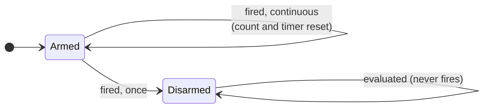
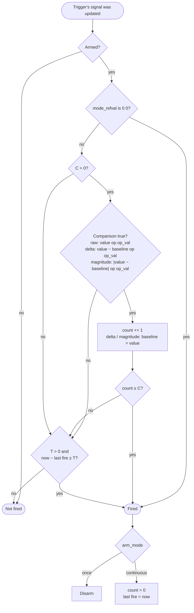
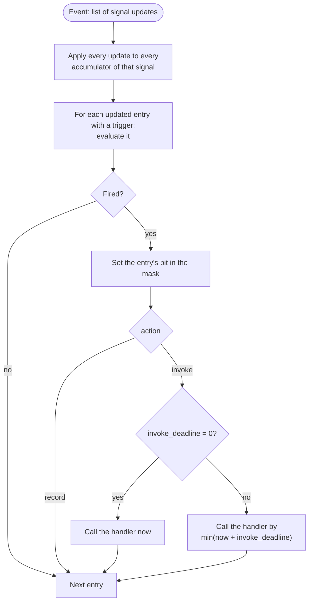

# PCM Trigger State Machine

How a PCM trigger decides when to call the handler, as implemented in
`htsim/sim/pcm/pcm_trigger.{h,cpp}` and `pcm_signal_state.{h,cpp}`. It follows
UE spec v1.1 §3.6.18.5. Where it differs from the spec, see
[pcm-plan.md](pcm-plan.md) §7.

Each signal entry in an algorithm's YAML file can have one trigger. A trigger
watches that entry's accumulator and is configured by:

| YAML field | Meaning |
|---|---|
| `op`, `op_val` | Comparison `accumulator (op) op_val`; `wc` is always true |
| `trigger_type` | `raw` compares the value; `delta` / `magnitude` (from the PCM paper) compare the change since the last true comparison |
| `mode_refval: C T` | Fire after `C` true comparisons, or once `T` × 128 ns have passed since it last fired |
| `arm_mode` | `once` or `continuous` (the spec's `disarmed` is rejected; see below) |
| `action` | `invoke` calls the handler; `record` only sets the trigger's bit in the mask |
| `invoke_deadline` | For `invoke`: how long the call may be delayed after firing (0 = call now) |

## Arm states

Every trigger starts armed. The spec lets a handler change, re-arm or disarm
triggers at runtime with `uet_modify_trigger()`, but that isn't implemented
here (plan §7 item 20): a trigger's configuration comes only from the YAML file.
So a `once` trigger fires a single time and then stays disarmed, and
`arm_mode: disarmed` is rejected when loading, since such a trigger could never
fire.

## What one evaluation does

A trigger is evaluated when an event (a received or sent packet, or a timer
event) updated its own signal (plan §7 item 2).

Notes:
- `mode_refval: 0 0` fires on every evaluation without comparing: the spec's
  "no evaluation is performed; trigger fires immediately if armed".
- The time condition doesn't use the comparison: it's "elapsed time since the
  trigger last fired". Before the first fire, time counts from when the trigger
  was created.
- The time condition is only checked when the trigger is evaluated. For a
  trigger on a `uet_time_*` signal, the runtime schedules timer events using
  `PcmTrigger::timeDue()`; a trigger on an ACK or NACK signal is checked at the
  next ACK or NACK.

## One event, all triggers

`PcmSignalState::applyEvent()` handles one event for a CCC:

All of an event's updates are applied before any trigger is checked, so updates
from one packet take effect together (§3.6.18.4.1). A trigger is evaluated at
most once per event, even if the event updated its signal twice.
